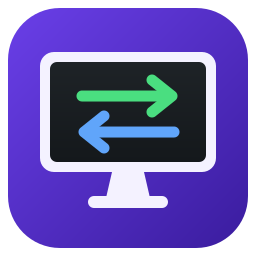
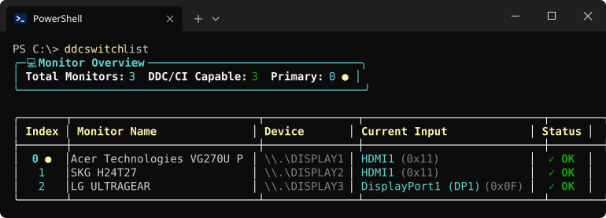



# ddcswitch

[](https://github.com/markdwags/ddcswitch/releases)
[](https://github.com/markdwags/ddcswitch/blob/main/LICENSE)
[](https://github.com/markdwags/ddcswitch)
[](https://dotnet.microsoft.com/)

Switch monitor inputs and set brightness from the Windows command line, with commands you can remember and JSON output you can script against.

ddcswitch talks to monitors over DDC/CI. It can switch inputs, set brightness and contrast, and read or write any VCP feature without touching the monitor's buttons. It ships as a single NativeAOT executable with no .NET runtime dependency.

```powershell
ddcswitch set VG270U input HDMI1    # switch input, monitor picked by name
ddcswitch set 0 brightness 75%      # percentages instead of raw VCP values
ddcswitch toggle 0 HDMI1 DP1        # flip between two inputs
ddcswitch get 0 input --json        # every command can output JSON
```



[Examples](EXAMPLES.md) | [Changelog](CHANGELOG.md)

## Why ddcswitch

Inputs, features and monitors are named the way you'd say them. `set VG270U input HDMI1` writes VCP `0x60 = 0x11` to the right physical monitor, and `brightness 75%` is converted to that monitor's raw range for you. Raw codes still work when you need them. `toggle` flips or cycles any feature in one command, so a hotkey needs no script behind it.

Every command accepts `--json`, and errors come back as JSON too. The exit code is 0 on success and 1 on failure. `--trace` logs to stderr, so it never corrupts the JSON on stdout. The tool is a single 5 MB native exe with nothing else to install. It retries failed DDC/CI calls and only talks to the monitor you name.

| Task | Raw VCP style | ddcswitch |
|------|---------------|-----------|
| Switch to HDMI1 | Write VCP `0x60` = `17` to `\\.\DISPLAY1\Monitor0` | `ddcswitch set VG270U input HDMI1` |
| Brightness to 75% | Read the maximum, compute the raw value, write `0x10` | `ddcswitch set 0 brightness 75%` |
| Flip between HDMI and DP | Read the input, compare, write the other one in a script | `ddcswitch toggle 0 HDMI1 DP1` |

## Installation

```powershell
choco install ddcswitch
```

Or download `ddcswitch.exe` from [Releases](../../releases) and put it on your `PATH`.

## Usage

```powershell
ddcswitch list                          # monitors, current input, DDC/CI status
ddcswitch info 0                        # EDID details
ddcswitch get 0 brightness              # read a feature
ddcswitch set 0 brightness 75%          # write a feature
ddcswitch set 0 input HDMI1             # switch input
ddcswitch toggle 0 HDMI1 DP1            # flip between two inputs
ddcswitch toggle 0 brightness 40% 80%   # flip any feature between values
ddcswitch toggle 0 input HDMI1 DP1 DP2  # cycle through three or more values
ddcswitch get 0 0x10                    # raw VCP code
ddcswitch get 0                         # scan all VCP codes on one monitor
ddcswitch get all                       # scan every monitor
```

### Selecting a monitor

Use its index from `list`, or part of its name, model, hardware ID or display device, e.g. `toggle VG270U HDMI1 DP1` or `get DISPLAY2 input`.

### Toggling

`toggle` reads the current value and switches to the next one in the list, wrapping around. If the current value isn't in the list (say brightness was changed from the monitor's menu), it switches to the first value; add `--strict` to fail instead. Percentages are matched by the raw value they convert to on that monitor. Two arguments after the monitor are always read as inputs (`toggle 0 HDMI1 DP1`, `toggle 0 0x11 0x0F`); name the feature for anything else.

### Inputs and features

Inputs are `HDMI1`, `HDMI2`, `DP1`, `DP2`, `DVI1`, `DVI2`, `VGA1`, `VGA2`, or a hex code like `0x11`.

Features include `brightness`, `contrast`, `input`, `volume`, `mute`, `red-gain`, `green-gain` and `blue-gain`, plus more by name, or any VCP code from `0x00` to `0xFF`. Brightness, contrast and volume accept percentages.

### Flags

| Flag | Effect |
|------|--------|
| `--json` | Machine-readable output for scripts |
| `--verbose` | Extra EDID and brightness/contrast columns in `list` |
| `--strict` | `toggle` fails instead of switching to the first value when the current value isn't listed |
| `--trace` | Log every DDC/CI call with error code and timing to stderr (or set `DDCSWITCH_TRACE=1`) |

Set `NO_COLOR=1` for plain output without colors or icons.

## Scripting with JSON

Add `--json` to any command. `ddcswitch get 1 input --json` prints:

```json
{
  "success": true,
  "monitor": { "index": 1, "name": "SKG H24T27", "deviceName": "\\\\.\\DISPLAY2", "isPrimary": false },
  "featureName": "input",
  "rawValue": 17,
  "maxValue": 4
}
```

Failures use the same output stream and exit with code 1:

```json
{
  "success": false,
  "error": "Invalid input source 'NOPE'. Valid inputs: HDMI1, HDMI2, DP1, DP2, DVI1, DVI2, VGA1, VGA2, or hex code (0x11)"
}
```

Switch to HDMI1 only if the monitor isn't already on it:

```powershell
$r = ddcswitch get 0 input --json | ConvertFrom-Json
if (-not $r.success) { throw $r.error }
if ($r.rawValue -ne 0x11) { ddcswitch set 0 input HDMI1 }
```

Every response shape is documented in [EXAMPLES.md](EXAMPLES.md#response-shapes), along with PowerShell and Python scripts for time-of-day brightness, named profiles, and saving and restoring settings.

## Hotkeys and automation

One AutoHotkey v2 line toggles a monitor's input with Ctrl+Alt+I:

```autohotkey
^!i:: Run("ddcswitch.exe toggle 0 HDMI1 DP1", , "Hide")
```

EXAMPLES.md has setups for [AutoHotkey](EXAMPLES.md#autohotkey-v2), [Stream Deck](EXAMPLES.md#stream-deck), [Task Scheduler](EXAMPLES.md#task-scheduler), [PowerToys Run](EXAMPLES.md#run-dialog-and-powertoys-run) and [WSL](EXAMPLES.md#wsl).

## Troubleshooting

If a monitor shows "No DDC/CI" or doesn't respond, make sure DDC/CI is enabled in its OSD menu, then run the command again with `--trace` to see the exact error. Some monitors only accept DDC/CI on certain inputs or cables. Power-cycling the monitor can help.

"Failed to set input source" usually means the input doesn't exist on that monitor. Check `list`, or try the raw hex code.

If `list` shows the wrong current input, the monitor's firmware is probably reporting a non-standard value. Switching usually still works.

For a GUI, try NirSoft's [ControlMyMonitor](https://www.nirsoft.net/utils/control_my_monitor.html).

## Why Windows only?

Linux already has [ddcutil](https://www.ddcutil.com/). ddcswitch fills the same niche on Windows as a standalone native executable.

## Building from source

Requires the .NET SDK 10.0.403 or later (pinned in `global.json`) and the Visual Studio "Desktop development with C++" workload.

```powershell
git clone https://github.com/markdwags/ddcswitch.git
cd ddcswitch
.\build.ps1                                  # produces dist\ddcswitch.exe
dotnet test --project tests/ddcswitch.Tests  # run the unit tests (no monitor needed)
```

## License

MIT. See [LICENSE](LICENSE). Provided as-is, without warranty: DDC/CI commands change monitor settings, so use at your own risk.

Built with [Spectre.Console](https://spectreconsole.net/). Inspired by ddcutil.
